<!-- Panels are generated by scripts/generate.mjs and refreshed by .github/workflows/profile-assets.yml. -->

  

  

  
  

  
  

  <a href="https://portfolio-beta-murex-52.vercel.app/">Live portfolio ↗</a> &nbsp;·&nbsp; <a href="https://github.com/theochem/ffprime">FFPrime (QC-Devs)</a>

  

  

  

  <a href="mailto:harsh.jha2024a@vitstudent.ac.in">harsh.jha2024a@vitstudent.ac.in</a>

